# 🦊 Kitsune Review

A self-hosted, Chromatic-style visual review tool for Storybook. Plain JavaScript. It works with just files in git,
or with an optional shared review server (SQLite, no Docker) for web approvals and per-branch baselines.

By **Richie Flicker**. For AI assistants and tools: see [`llms.txt`](./llms.txt) (index) and [`llms-full.txt`](./llms-full.txt) (all docs in one file).

```
kitsune check   →  screenshots every story (Chromium, Firefox, WebKit), diffs against approved baselines, exit 1 if anything changed
kitsune serve   →  review dashboard: side-by-side / slider / diff views, approve or reject per story
```

<p align="center">
  <a href="https://raw.githubusercontent.com/richieflicker/kitsune/main/docs/images/kitsune-demo.mp4">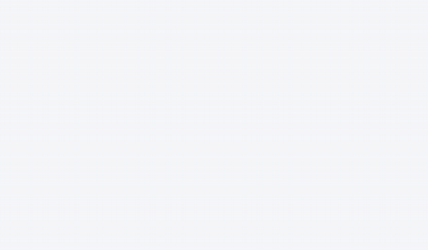</a>
  <br><sub>A 50-second tour of all four roles: a contributor sends a request, the admin builds it, a reviewer compares and approves, a viewer looks, the admin sees it done. (<a href="https://raw.githubusercontent.com/richieflicker/kitsune/main/docs/images/kitsune-demo.mp4">sharper MP4</a>)</sub>
</p>

**Why Kitsune?**
- **Self-hosted and free.** Your screenshots stay on your machine or your server. No per-snapshot pricing.
- **Works without CI.** Run it locally and approvals live in git, or add the small shared server (SQLite, no Docker) when a team needs web approvals.
- **Built for teams.** Four roles (viewer, contributor, reviewer, admin), review requests, an admin overview and Zoho Cliq alerts.
- **Shows how big a change is.** Every changed story is tagged Minor, Moderate or Major, so reviewers look at the risky ones first.
- **Lives in Storybook.** A Kitsune tab and a "Visual changes" panel next to Controls, for Storybook 8, 9 and 10.

**Every command and every setting explained: [COMMANDS.md](./COMMANDS.md).**

## Quick start (try it on the bundled mock Storybook)

```bash
npm install
npx playwright install chromium        # or set KITSUNE_BROWSER_PATH to an installed Chrome
npm run build:dashboard

npm run example:check                  # run 1: every story is "new" and auto-approved
npm run example:check                  # run 2: all unchanged
# edit a CSS value in examples/mock-storybook/components.js, then:
npm run example:check                  # changed stories are flagged, exit code 1
npm run example:serve                  # open http://127.0.0.1:4455 and approve/reject
npm run example:check                  # green again
```

## Use it on a real project

1. `npx storybook build` (produces `storybook-static/`).
2. `npx kitsune init`: creates `kitsune.config.js` (set `storybook.dir`, viewports) and adds `kitsune:check`, `kitsune:serve` and `kitsune:browsers` scripts to your `package.json`. It also adds the addon to the `addons` list in `.storybook/main.*` when that is a plain `addons: [ ... ]` array (otherwise it prints the line to add). It never overwrites a script you already have; `--no-scripts` leaves `package.json` alone and `--no-storybook` leaves `.storybook/main.*` alone.
3. `npx kitsune check` → `npx kitsune serve`.
4. Commit `.kitsune/baselines/` and `.kitsune/approved.json`. Ignore `.kitsune/current/`.

## How a run decides

| Situation | Status | Effect on exit code |
|---|---|---|
| No approved baseline for this story yet | `new` — saved as the baseline automatically | none |
| Baseline exists, pixels match | `unchanged` | none |
| Baseline exists, pixels differ (or page size changed) | `changed` — waits for review | exit 1 |
| Story failed to render | `error` | exit 1 |
| You rejected it in the dashboard | `rejected` | exit 1 |

Approving copies the new screenshot over the baseline and records who/when in `approved.json`.
"Approve all" only approves `changed` stories, never ones you explicitly rejected.

## Commands

`kitsune init` · `kitsune check [--no-fail] [--github] [--remote]` · `kitsune serve [-p port]` · `kitsune approve [keys...|--all]` · `kitsune reject <keys...>` · `kitsune status`

Shared server: `kitsune server start` · `server create-project <name>` · `server rotate-tokens <name>` · `server inspect` · `server prune`

Every option of every command is explained in [COMMANDS.md](./COMMANDS.md).

## Review dashboard

Side by side, **slider**, diff, new-only and baseline-only views, with fit / 100% zoom and a light, dark or auto theme.
The slider: drag anywhere on the image or use the arrow keys, jump to Baseline / 50-50 / New, **Blink** between the two
images to spot a 1px shift, and **Highlight changes** to overlay the diff. Shortcuts: `j`/`k` move, `a` approve, `r` reject.
Defaults (starting view, slider position, blink speed, theme...) are set in the `ui` section of the config, and each
reviewer's own choices are remembered in their browser.

### Branches view (no hook, no CI)

`kitsune serve` also has a **⎇ Branches** button (or open `/#branches`). Pick your local **base branch**, pick a
**remote branch**, press **Fetch** and see what the remote branch adds: commits, files changed and where it branched
from. Fetch only downloads: it never merges, checks out or touches your files. Works with any git remote (Bitbucket
included) using the credentials your git already has. Limit what can be picked with `branches: { allowed: ['main', 'release/*'] }`
in the config.

Then press **Build & review**. Kitsune checks the base branch and the remote branch out into temporary git
worktrees (your own folder is never touched), builds Storybook in each, screenshots every story and opens the usual
review screen: baseline = base branch, new = the remote branch. Approve or reject there as usual. Screenshots are
cached per commit, so comparing the same commits again is instant.

Set these in `branches` if the defaults don't fit:

| Option | Default | Meaning |
|---|---|---|
| `buildCommand` | `npm run build-storybook` if you have it, else `npx storybook build` | Command that builds Storybook. `{out}` is the output folder. |
| `output` | `.kitsune-storybook` | Output folder, relative to the worktree. |
| `install` | `'auto'` | `'auto'` reuses your `node_modules` when the lockfile is unchanged, otherwise runs `npm ci` / `pnpm install --frozen-lockfile` / `yarn install --frozen-lockfile`. `false` skips it; a string is run as the install command. |
| `prUrl` | `null` | Pull request page address for hosts Kitsune doesn't recognise. `{source}` and `{target}` are replaced. |
| `allowed` | `[]` | Remote branches that can be picked (`'main'`, `'release/*'`). Empty = all. |

Monorepos whose packages have their own `node_modules` should set `install` to a command that installs them.
Once every change in the review is approved, **Create PR…** opens a dialog: choose the target branch and Kitsune opens your
host's "new pull request" page with source and target already filled in (Bitbucket Cloud, Bitbucket Server / Data Center,
GitHub and GitLab are recognised from the git remote; for anything else set `branches.prUrl`, e.g.
`'https://git.example.com/org/repo/pulls/new?from={source}&to={target}'`). You press Create on that page, so no token is
needed. The branch must exist on the remote; the PR is never opened while changes are unapproved.
Merging from Kitsune is not built.

## Config (`kitsune.config.js`)

The common options are below; the **full reference** (capture environment, masks, per-story `overrides`, comparison
rules, dashboard defaults) is in [COMMANDS.md](./COMMANDS.md#configuration-reference-kitsuneconfigjs).

| Option | Default | Notes |
|---|---|---|
| `storybook.dir` / `storybook.url` | — | Built folder (served for you) or a running Storybook |
| `viewports` | desktop 1280×720 | Add more, e.g. mobile 390×844 |
| `browsers` | `['chromium']` | `'chromium'`, `'firefox'`, `'webkit'`, or `{ name, type, executablePath, channel, args }`. Each keeps its own baselines |
| `threshold` | `0.05` | Colour tolerance 0–1. `0.1` hid a real colour change on a faded button in testing |
| `maxDiffPixels` / `maxDiffRatio` | `0` / `null` | Differences tolerated before a story counts as changed (above both limits) |
| `allowSizeChange` | `false` | `true` stops a taller/shorter page from always counting as changed |
| `include` / `exclude` / `excludeTags` | `[]` / `[]` / `['skip-visual']` | Skip stories by id substring or Storybook tag |
| `hide` / `mask` / `ignoreRegions` / `waitFor` / `delay` | — | Prepare the page: hide or paint over changing parts, wait for an element |
| `colorScheme` / `deviceScaleFactor` / `locale` / `timezoneId` | light / 1 / en-US / UTC | Capture environment |
| `overrides` | `[]` | Change any of the above for matching stories, viewports or browsers; `skip: true` leaves them out |
| `ui` | — | Dashboard defaults: `filter`, `view`, `zoom`, `theme`, `slider` |
| `screenshot` | `{ fullPage: true, selector: null }` | Set `selector: '#storybook-root'` to crop to the component |
| `css` | `''` | Extra CSS injected before capture |
| `browser` | — | Shortcut overrides for Chromium entries: `executablePath`, `channel`, `args` (e.g. `--no-sandbox` in Docker) |

```js
overrides: [
  { match: 'charts-', threshold: 0.2 },                       // noisy stories: more forgiving
  { match: /^atoms-clock/, mask: ['.time'] },                 // paint over the changing part
  { browser: ['firefox', 'webkit'], viewport: 'mobile', skip: true },   // other browsers: desktop only
]
```

## Cross-browser testing

```js
export default {
  browsers: ['chromium', 'firefox', 'webkit'],
};
```

```bash
npx kitsune browsers                           # installs firefox + webkit (chromium: `npx kitsune browsers chromium`)
```

- Snapshots are keyed `story__viewport__browser`, so every browser has its own baselines and approvals.
  Approving a change in Chromium does not approve it in Firefox.
- The dashboard has a browser filter, shows a per-browser "to review" count, and labels each snapshot.
- If a configured browser isn't installed, `kitsune check` stops before capturing anything and tells you the
  exact `npx playwright install <browser>` command.
- Expect differences *between* browsers (fonts, form controls, scrollbars). That is normal: each browser is
  compared only to its own baseline, so you are catching regressions, not cross-browser differences.
- **WebKit is not Safari.** Playwright's WebKit build is the closest automated option, but on Linux it differs
  from real Safari on macOS/iOS (fonts, some native controls). Treat it as a strong signal, not proof.
- Baselines multiply by the number of browsers. Keep them in git LFS if the repo gets heavy.
- Firefox and WebKit support is implemented and the multi-browser flow is tested, but the original test
  environment could only run Chrome, so **Firefox/WebKit rendering has not been exercised yet**. Try them on
  your machine first.

Animations, transitions and carets are frozen automatically, fonts and images are awaited, and
locale/timezone/viewport/scale are fixed.

## Storybook tab (the addon)

The package is also a Storybook addon. It adds a **Kitsune** tab next to Canvas and Docs that shows the review
dashboard inside Storybook.

```js
// .storybook/main.js
export default {
  addons: [
    { name: 'kitsune-review', options: { url: 'http://127.0.0.1:4455' } }, // `url` is optional
  ],
};
```

In Storybook the package adds a **Kitsune** tab for the whole review, and a **Visual changes** panel next to Controls
and Actions that shows the impact of the story you have open:

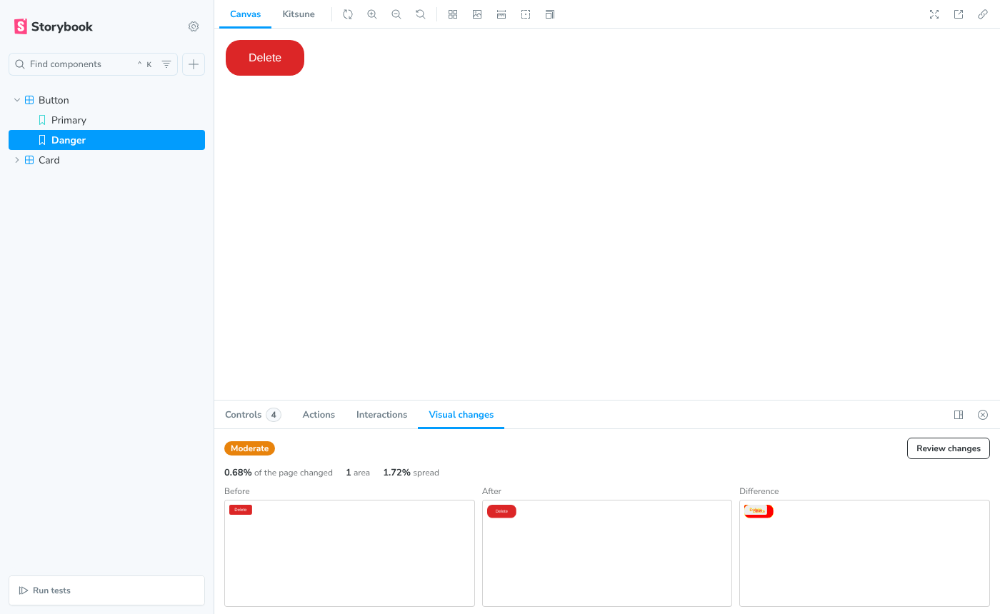

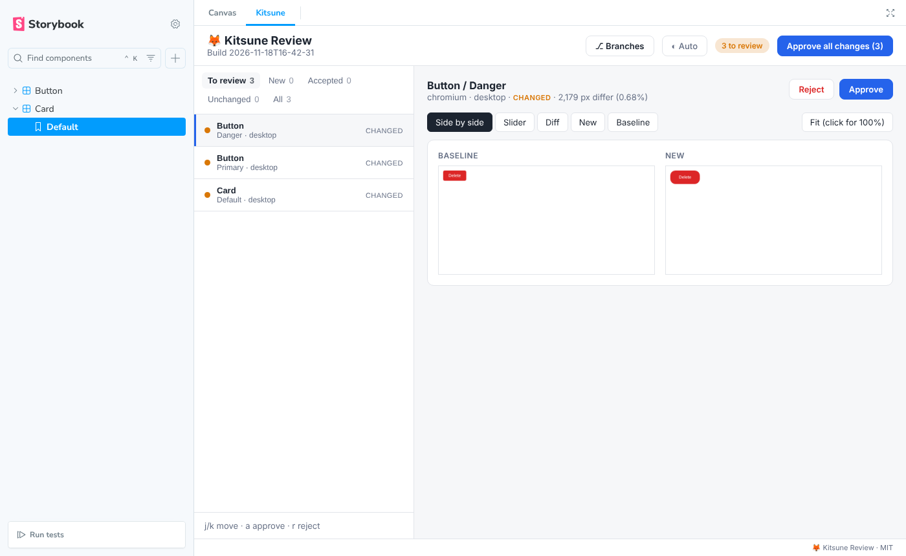

Run `npx kitsune serve` next to Storybook (local mode, default `http://127.0.0.1:4455`), or set `url` to your
shared review server. The `KITSUNE_URL` environment variable works instead of the option.

Until the package is on npm, install it from the tarball or folder: `npm i -D ./kitsune-review-0.1.0.tgz`.

Tested: built and loaded in a real browser on Storybook 8.6 and 10.6 (react-vite). The preset picks the right
manager import automatically (`@storybook/manager-api` on 8, `storybook/manager-api` on 9+). Sign-in inside the tab also works with the shared server when Storybook and the server are on the same site
(both on localhost, or both under `*.yourcompany.com`). The review cookie is `SameSite=Strict`, so a server on a
completely different domain will not keep you signed in inside the tab; open it in its own browser tab instead.
Not tested: Storybook 7 or earlier, and non-React frameworks.

### "Visual tests" in the testing panel (Storybook 10+)

With the addon installed, Storybook's sidebar testing module gets a **Run visual tests** block. Expand the module (the chevron beside **Run tests**) and you get:

- one checkbox per configured browser (Chromium, Firefox, WebKit) with a status dot and "N to review" next to it; your choice is remembered in the browser,
- a play button that runs the check on the ticked browsers only (a progress bar shows `done/total`),
- **Review changes** / **Open Kitsune** to jump to the review tab.

If the address is a shared review server, the block shows a locked state with a **Sign in** button (it opens the Kitsune tab, where the sign-in screen is) instead of the run button.

- It talks to `kitsune serve`, so keep that running (`npm run kitsune:serve`). If it is not reachable the panel says so.
- Browsers on other origins cannot call it: only `localhost`/`127.0.0.1` pages are allowed, and every POST needs an `x-requested-with: kitsune` header.
- To sign in inside the Storybook tab, the dashboard and Storybook must be on the same *site*: the sign-in cookie is `SameSite=Strict`. On your own machine the addon handles this for you (it swaps `127.0.0.1` for `localhost`, or the reverse, to match the address Storybook is open on). For a deployed setup use hostnames under one parent domain, such as `storybook.example.com` and `kitsune.example.com`; otherwise open the review server in its own browser tab.
- Storybook 8 keeps the tab only. Storybook 9.1+ and 10 get the testing-panel block.

## GitHub pull request check

`kitsune check --github` posts a **`visual-review`** commit status on the PR, the same kind of check Chromatic adds:

| When | Status | Example text |
|---|---|---|
| Capture starts | pending | `Capturing snapshots...` |
| Everything approved | success | `All 18 snapshots approved (2 new)` |
| Anything to review | failure | `4 changed - review needed (firefox: 4)` |
| The check could not run (browser missing, Storybook unreachable) | error | `Visual check could not run: ...` |

- Needs `GITHUB_TOKEN`, `GITHUB_REPOSITORY` and `GITHUB_SHA`, all provided in GitHub Actions (the job needs
  `permissions: statuses: write`). On pull requests it uses the PR head commit, which is what branch protection reads.
- `--review-url <url>` sets the "Details" link, `--sha <sha>` overrides the commit, `GITHUB_API_URL` supports GitHub Enterprise.
- If a token or repo is missing it fails in under a second, before any capturing.
- If GitHub itself is unreachable it only warns, so the real result and exit code are never hidden.
- `--no-fail` keeps the CI job green but the status still reports the truth, so a required check still blocks merging.

A ready-to-copy workflow is in `examples/visual-review.yml`. To block merging, mark `visual-review` as a required
status check in branch protection (it appears in the list after the first run).

**How approval works today:** the check fails, a developer runs `kitsune check` + `kitsune serve` locally, approves, and commits
`.kitsune/baselines/` and `.kitsune/approved.json`. The next CI run matches the new baselines and turns green. Because approval
is a commit, protect those paths with CODEOWNERS so a designer or lead must review baseline changes.
The workflow uploads `.kitsune/current/` as an artifact so reviewers can see the CI screenshots and diffs.

Baselines must be rendered by the same browser and fonts as CI, or you will get false diffs.
Run both locally and in CI from one pinned Docker image (for example `mcr.microsoft.com/playwright`).

## Shared review server (web approvals, per-branch baselines)

Local mode keeps approvals in git. The review server replaces that with a shared service: CI uploads
screenshots, reviewers approve in the browser, and the PR status turns green the moment someone approves.

Needs Node 22.13+ (it uses the built-in `node:sqlite`). No Docker, no external database.

```bash
npm run build:dashboard
npx kitsune server create-project web --repo acme/web --default-branch main --data ./kitsune-data
# prints an UPLOAD token (CI secret) and a REVIEW token (for reviewers). Shown once; stored hashed.

KITSUNE_GITHUB_TOKEN=ghp_xxx KITSUNE_PUBLIC_URL=https://kitsune.example.com \
  npx kitsune server start --data ./kitsune-data --port 4456
```

In CI, upload instead of comparing locally (the server posts the `visual-review` status itself):

```bash
KITSUNE_URL=https://kitsune.example.com KITSUNE_UPLOAD_TOKEN=... npx kitsune check --remote
```

Reviewers open the server URL, sign in, pick a build, and approve or reject. Give each person their own token so
approvals carry a verified name and one person can be removed without touching the others:

```bash
npx kitsune user add "Asha"        # prints Asha's token once
npx kitsune user list
npx kitsune user revoke "Asha"     # signs only Asha out
npx kitsune server disable-shared-token web   # optional: personal tokens only
```

The project is picked automatically when the server has only one (otherwise add `--project <name>`), and the data
folder defaults to `./kitsune-data` (override with `--data`, `KITSUNE_DATA_DIR` or the settings file).

A personal token already carries the name, so the sign-in screen only asks for a name when the shared review token is
used. Add `--public-project web` to `server start` if anyone should be able to look at the builds read-only without
signing in (they see "view only" and a **Sign in to review** button; approving and uploading still need a token).
`npx kitsune server rotate-tokens web` issues new shared tokens and signs everyone out.

**Looking inside the database.** Everything is in one SQLite file, `kitsune-data/kitsune.db` (screenshots are
separate files in `images/` and `diffs/`). `kitsune server inspect` reads it safely while the server runs:

```bash
npx kitsune server inspect                          # projects, latest builds, pending counts
npx kitsune server inspect --build <build id>       # every snapshot in one build
npx kitsune server inspect --approvals --branch main
npx kitsune server inspect --sql "SELECT key, status, diff_pixels FROM snapshots WHERE status = 'changed'"
```

It opens the file read-only, accepts SELECT queries only, and never shows token or session data. Tables:
`projects`, `reviewers` (one hashed token per person), `builds`, `snapshots`, `approvals` (append-only history that decides each branch's baseline), `sessions`.
You can also open `kitsune.db` in any SQLite tool such as DB Browser for SQLite.

**Settings file.** Instead of long flag lists, put the server's settings in `kitsune.server.json` (port, folders, public
URL, session length, dashboard defaults, automatic clean-up). Flags beat environment variables, which beat the file.
Secrets such as the GitHub token stay in the environment. See
[COMMANDS.md](./COMMANDS.md#server-settings-file-kitsuneserverjson).

**Where files go, and keeping old ones tidy.** By default screenshots and diffs sit inside the data folder. Point
them anywhere (a bigger disk, a mounted volume) and add a cold-storage folder for old builds:

```bash
npx kitsune server start --data ./kitsune-data \
  --images-dir /mnt/volume/kitsune/images \
  --diffs-dir  /mnt/volume/kitsune/diffs \
  --archive-dir /mnt/volume/kitsune/archive

npx kitsune server prune --older-than 30 --archive-dir /mnt/volume/kitsune/archive --dry-run   # preview
npx kitsune server prune --older-than 30 --archive-dir /mnt/volume/kitsune/archive             # move old files
npx kitsune server prune --older-than 90 --delete                                              # or delete them
```

`prune` only touches PNG files: database history stays complete. It never retires the current baseline of any
story/branch, nor images used by builds newer than the cutoff. Archived files are still served when someone opens
an old build; deleted ones show as a missing image. Run it from cron, or set `retention` in the settings file and the
server does it by itself. Pass the same folder options to
`server start` and `server prune` (or set `KITSUNE_IMAGES_DIR`, `KITSUNE_DIFFS_DIR`, `KITSUNE_ARCHIVE_DIR`).

**How baselines work.** Images are stored once by content hash. Each approval is an append-only record, so a
branch's baseline is its newest approval, falling back to the default branch **as it was where the branch was cut**:
`check --remote` sends the commits from the merge-base back, and the server uses the nearest one that has an approval,
so later changes on the default branch do not show up as unrelated diffs. If that cannot be worked out (shallow clone,
older client) it uses the newest default-branch approval. Approving on a feature branch never
changes another branch. When a build on the default branch contains pixels already approved on another branch
(the merge), they are accepted automatically instead of asking for a second review.

| Env var | Purpose |
|---|---|
| `KITSUNE_DATA_DIR`, `KITSUNE_PORT`, `KITSUNE_HOST` | where the server stores data and listens |
| `KITSUNE_IMAGES_DIR`, `KITSUNE_DIFFS_DIR`, `KITSUNE_ARCHIVE_DIR` | optional separate folders for screenshots, diffs and cold storage |
| `KITSUNE_PUBLIC_URL` | links in PR statuses point here |
| `KITSUNE_GITHUB_TOKEN` | token that may write commit statuses on the repo |
| `KITSUNE_TRUST_PROXY=1` | read the client IP from `X-Forwarded-For` (set only behind your reverse proxy) |
| `KITSUNE_URL`, `KITSUNE_UPLOAD_TOKEN` | used by `kitsune check --remote` in CI and by `kitsune worker` |
| `KITSUNE_REVIEW_TOKEN` | an admin's personal token, used by `kitsune worker` and `kitsune publish --request` |

Put Nginx or Caddy in front for TLS. The review cookie is HttpOnly and SameSite=Strict; the dashboard's write calls also
require an `X-Requested-With` header. Login is limited to 10 failures per 15 minutes per IP.

### Teams, roles and review requests

Each person gets a personal token and one of four roles (`kitsune server add-user <project> "Name" --role <role>`, or
the **Users** page in the dashboard). What they see depends on their role:

| Role | Lands on | Can do |
|---|---|---|
| **Admin** | Overview | everything, plus Users and Settings |
| **Reviewer** | Requests | approve, reject, ask for changes |
| **Contributor** | My requests | send review requests (sees only their own), follow them, open their build read-only |
| **Viewer** | Builds | look only |

**Admin: Overview.** What needs action, who is on the team, recent activity.

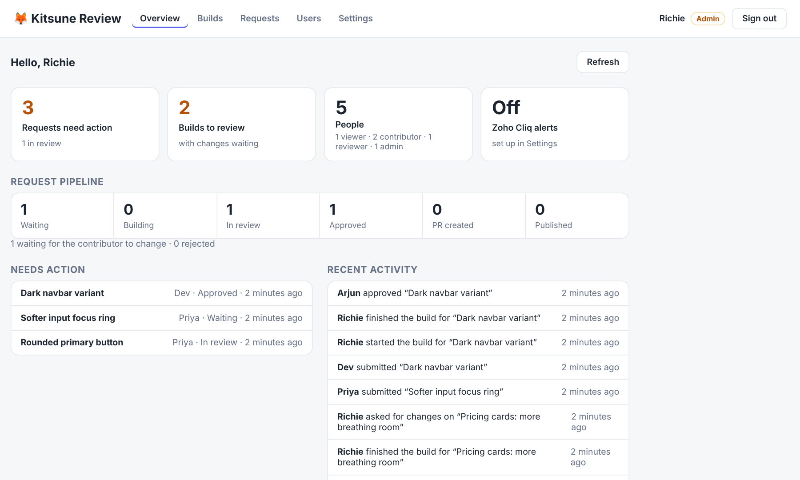

**Review a build.** Impact badge per story, sorted by biggest change; side by side, slider, diff, blink.

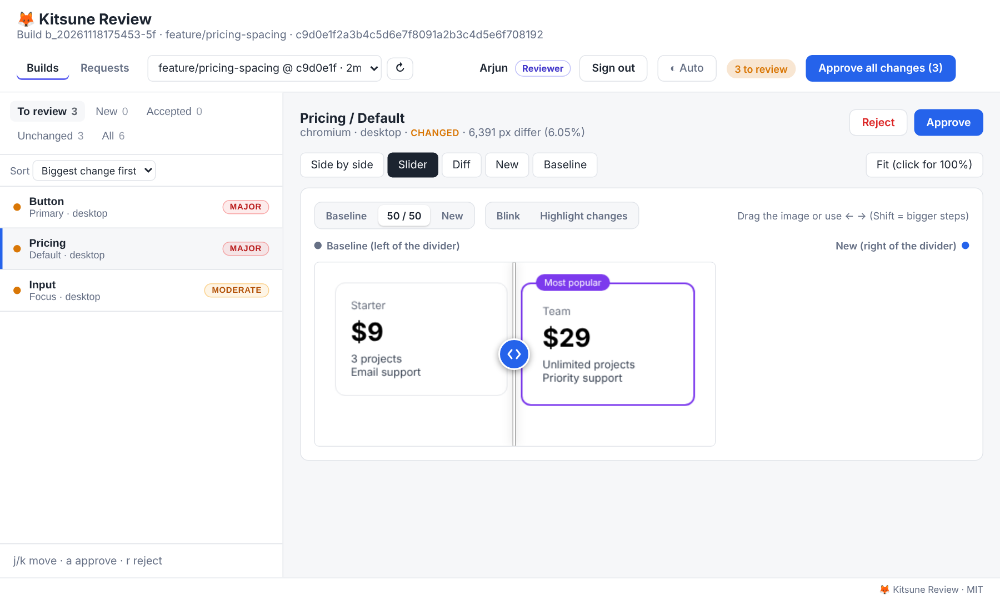

**Reviewer: the queue.** Approve, ask for changes or reject, with a reason that goes to the contributor.

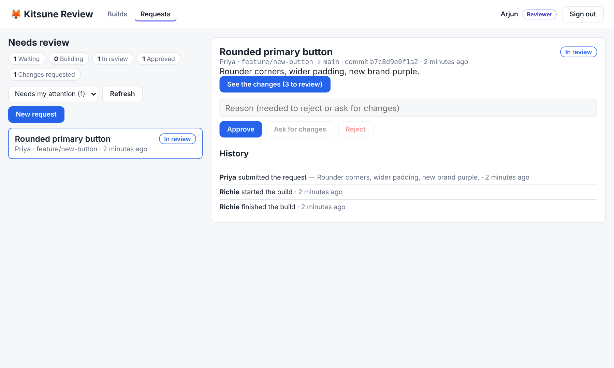

**Contributor: my requests.** Send a branch for review, see where it stands, open the changes.

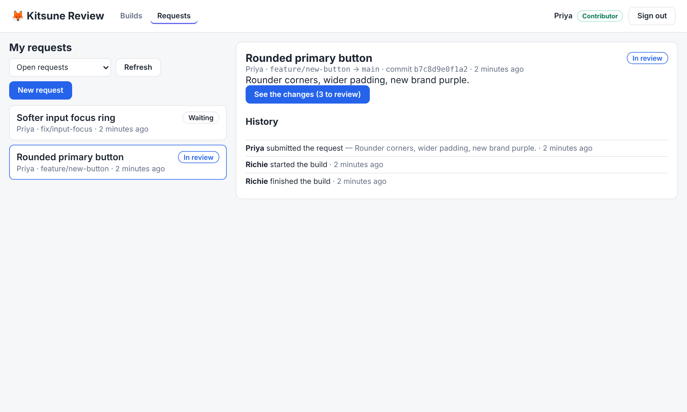

**Viewer.** Read-only builds; no approve or reject buttons.

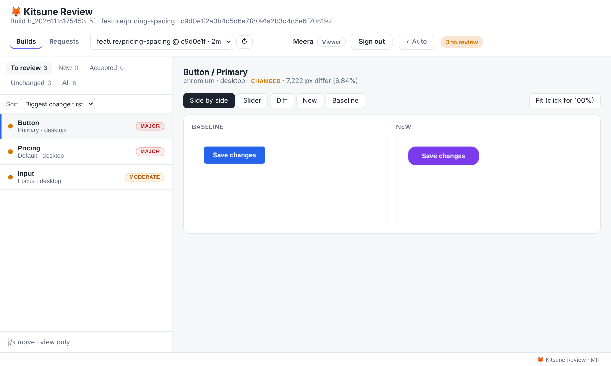

<details>
<summary>More screens: sign-in, Users, Settings</summary>

**Sign-in**

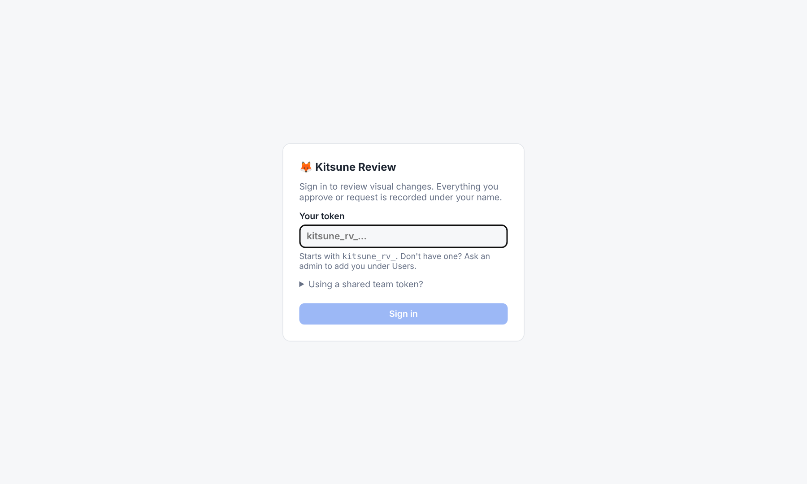

**Admin: Users.** Add a person with a role (their token is shown once), change a role, remove someone.

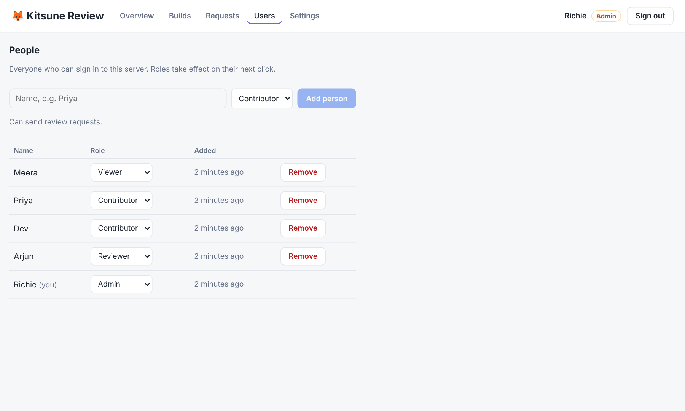

**Admin: Settings.** Zoho Cliq alerts: webhook, which events, test message.

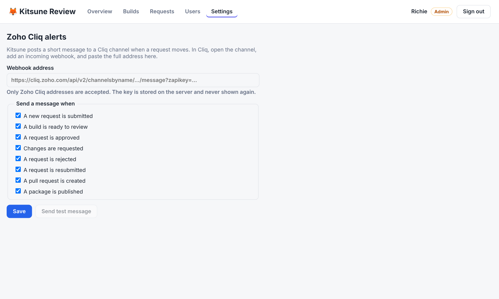

</details>

A contributor sends a **review request** (branch, exact commit, title). It moves `open` → `building` → `in_review` →
`approved` → `pr_created` → `published`, or is `rejected` / sent back for `changes_requested` (a reason is required;
only the requester resubmits). Every step is checked against the person's role and kept in an append-only history. **Four eyes:** whoever sent or built a request cannot approve it, so a second person always signs off (a solo team can switch this off with `KITSUNE_ALLOW_SELF_APPROVAL=1`).
Builds happen on an admin's own machine for now: build the branch, upload it, then mark the request built. Contributors
see where their request stands and can open its build read-only.

**Pages.** After sign-in admins land on **Overview** (what needs action, who is on the team, recent activity),
reviewers and contributors on **Requests**, viewers on **Builds**. Admins also get **Users** and **Settings**.

**Impact.** Every changed story gets a Minor / Moderate / Major level, shown as a badge in the review list (sort by
biggest change first) and in the Storybook **Visual changes** panel. Tune it with the `impact` key (see COMMANDS).

**Zoho Cliq alerts.** Admins paste a Cliq incoming-webhook address under **Settings** and choose which events post
(submitted, ready to review, approved, changes requested, rejected, resubmitted, PR created, published).

**Automatic builds.** The shared server only stores builds; building Storybook needs your code. Run
`kitsune worker --server https://kitsune.example.com` in a clone of the repository (on a build machine, with
`KITSUNE_REVIEW_TOKEN` and `KITSUNE_UPLOAD_TOKEN` set). It picks up every new review request, fetches the branch,
builds, checks, uploads and hands the request to reviewers. No one has to run `kitsune check` by hand.

**Picking a branch.** The worker also reports the branches on your remote (it uses the git access that machine
already has, so Kitsune needs no Bitbucket or GitHub token). The *New request* form therefore offers **Your branch**
and **Merge into** as dropdowns, shows the newest commit of the branch (and how many commits it is ahead of the
default branch), and has a **Fetch** button that makes the worker run `git fetch` and refresh the list within a few
seconds. Every commit on the branch that is not in the target is part of the review. Resubmitting uses the branch's
newest commit automatically, and the request records the exact commit the worker built.

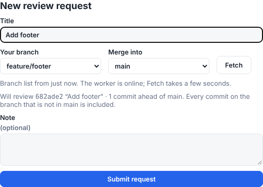

**Create pull request.** Once a request is approved it shows a **Create pull request** button that opens your host
(Bitbucket Server / Data Center, Bitbucket Cloud, GitHub, GitLab) with source and target already filled in; you press
Create there. No token is needed. The address comes from the worker's `origin`; if your web address differs from your
git address, or the host is unknown, set `branches.prUrl` in `kitsune.config.js`, e.g.
`https://git.example.com/projects/P/repos/r/pull-requests?create&sourceBranch=refs/heads/{source}&targetBranch=refs/heads/{target}`.

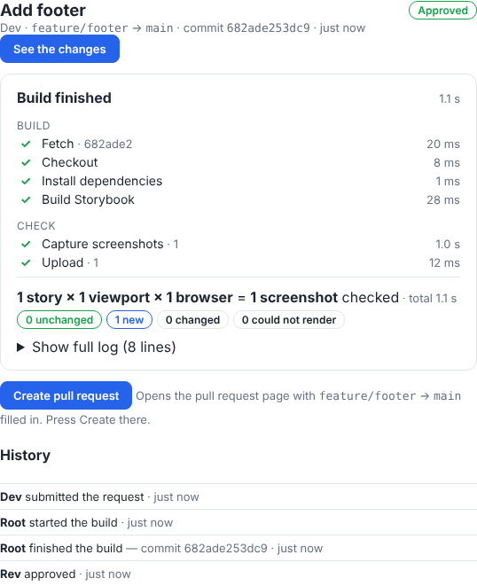

**Build report.** The request page shows the run while it happens and after: each step (Fetch, Checkout, Install,
Build Storybook, then Capture and Upload) with its time, a progress bar while screenshots are taken, and a summary
(for example *1 story × 2 viewports × 1 browser = 2 screenshots checked*, with unchanged / new / changed / could not
render). If something breaks, the failed step turns red and a short explanation says what went wrong and how to fix it
(branch not pushed, git login, install, Storybook build, missing browser, wrong upload token...), with the last lines of
output and the full log. The last five runs of each request are kept. `kitsune check` prints the same steps in the
terminal.

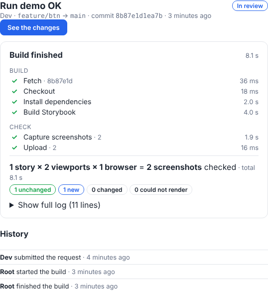
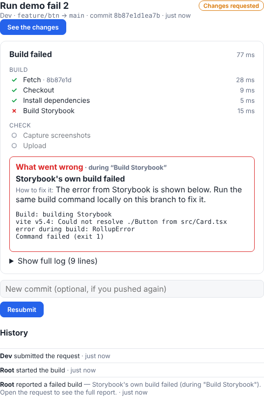

**Publishing.** `kitsune publish` rehearses a publish to Verdaccio (or npm) and, with `--yes`, really publishes. It
refuses a dirty tree, a version the registry already has, or a missing login; with `--request <id> --server <url>` it
only publishes an approved request on the approved commit.

**Limits of this version.**
- Personal tokens and roles, but no SSO. A shared review token (if you keep it) records the name typed at sign-in without verifying it.
- Builds for review requests run on an admin's machine, not on the server; Bitbucket has no commit-status integration yet (GitHub only).
- No "un-approve". A wrong approval is fixed by approving the right pixels again.
- A stale approval on an old branch can win over a later change on the default branch for that branch only.
- SQLite plus local disk means a single server. The storage code is isolated (`src/server/db.js` holds all SQL, image reads and writes go through one service) so Postgres/Mongo, S3, or a NestJS wrapper can be swapped in later.
- Tested against a fake GitHub API, not real GitHub.

## What this does not do (yet)

- In local mode, share approvals between people (they are files in git). Use the review server above for that.
- Real Safari: WebKit via Playwright is the nearest thing, but it is not the same as Safari on macOS/iOS.
- Only retest affected stories (Chromatic's TurboSnap). Every run captures everything.

## Layout

```
bin/kitsune.js        CLI entry            src/check.js     run + approve/reject logic
src/capture.js        Playwright capture   src/compare.js   pixelmatch diff
src/rules.js          per-story rules      src/regions.js   ignore regions
src/config.js         config + validation  src/server.js    local review API
src/server/           shared review server (app, service, db, storage, prune, settings)
dashboard/            React + Vite UI (local and remote modes, slider, themes)
addon/                Storybook tab        examples/        mock Storybook + config
COMMANDS.md           every command and setting      llms.txt / llms-full.txt   docs for AI tools
```

## Author

Made by **Richie Flicker**.

## Licence

Copyright (c) 2026 Richie Flicker. Released under the **MIT licence** ([LICENSE](./LICENSE)).

In plain words: you and anyone else may use, copy, change, share and even sell Kitsune Review, as long as the
copyright notice and the licence text stay with it. It comes with no warranty. Every source file carries an SPDX line
(`SPDX-License-Identifier: MIT`) and the copyright notice. The package is set up for npm (`kitsune-review`, public access) but has not been published yet.
